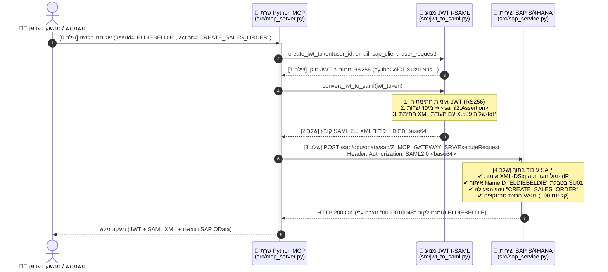

<div align="right">
  <a href="https://github.com/eldiebeldie">
    
  </a>
  
</div>

<div dir="rtl" align="center">

# ⚡️ MCP ➔ JWT ➔ SAML 2.0 ➔ SAP S/4HANA (Python)
### *סביבת ההדגמה האולטימטיבית להעברת זהות משתמש (Principal Propagation) מסוכני AI אל SAP*

[](https://github.com/eldiebeldie)
[](https://www.python.org)
[](https://modelcontextprotocol.io)
[](https://www.sap.com)
[](#)
[](./LICENSE)

<p align="center">
  🌐 <a href="./README.md"><strong>Read in English (אנגלית)</strong></a> | 🇮🇱 <strong>קריאה בעברית</strong>
</p>

<p align="center">
  <strong>סוכני AI מודרניים מדברים ב-MCP ובטוקנים מסוג JWT. מערכות SAP ארגוניות מדברות ב-SAML 2.0 XML Assertions.</strong><br/>
  בנוי באמצעות <strong>Python MCP SDK הרשמי (<code>MCPServer</code>)</strong>, <strong>FastAPI</strong>, <strong>PyJWT</strong> ו-<strong>cryptography</strong> — כולל ממשק <strong>Flow Studio אינטראקטיבי עם 6 ערכות נושא</strong>.
</p>

</div>

---

<div dir="rtl">

## 🎯 הסיפור מאחורי הפרויקט: למה זה בכלל קיים?

דמיינו סוכן AI שרוצה ליצור הזמנת לקוח (`VA01`) או לאשר דרישת רכש (`ME54N`) במערכת **SAP S/4HANA** בשמו של משתמש אנושי אמיתי (`ELDIEBELDIE`).
בעולם הארגוני, **לעולם** לא נרצה להשתמש במשתמש מערכת טכני משותף ב-SAP — אנחנו חייבים **Principal Propagation (העברת זהות משתמש)** כדי ש-SAP תדע בדיוק *מי* האדם האמיתי שעומד מאחורי הבקשה, תבדוק את ההרשאות שלו ב-`SU01`, ותתעד את שם המשתמש המדויק ביומן הביקורת (Audit Log).

כך הזרימה שלנו ב-Python הופכת את התהליך לפשוט ומהיר:
1. 🗣️ **אתם שולחים בקשה לשרת ה-MCP ב-Python** לבצע פעולה עסקית ב-SAP עבור משתמש מסוים.
2. 🪙 **שרת ה-MCP מנפיק טוקן JWT חתום (RS256)** הכולל את זהות המשתמש ואת פרטי הבקשה העסקית.
3. 🧬 **טוקן ה-JWT מומר להצהרת OASIS SAML 2.0 Bearer Assertion**, הנחתמת דיגיטלית באמצעות תעודת X.509 (`XML-DSig RSA-SHA256`).
4. 🏢 **מערכת ה-SAP מקבלת את טוקן ה-SAML 2.0**, מאמתת את החתימה הקריפטוגרפית של ה-XML, מזהה את משתמש ה-SAP (`ELDIEBELDIE` או `ALICE_FIN`), מזהה את הפעולה העסקית המבוקשת, ומבצעת את הטרנזקציה ב-SAP!

---

## 🗺️ ארכיטקטורה וזרימת המידע באופן ויזואלי

### 1. תרשים זרימה עילי (`Client ➔ MCP ➔ JWT ➔ SAML 2.0 ➔ SAP`)

```mermaid
flowchart LR
    subgraph ClientLayer["💻 1. סוכן AI / ממשק דפדפן"]
        A["🧑 בקשת משתמש<br/>(משתמש: ELDIEBELDIE<br/>פעולה: CREATE_SALES_ORDER)"]
    end

    subgraph MCPLayer["🧠 2. שרת Python MCP (src/mcp_server.py)"]
        B["🪙 כלי: create_jwt_token<br/>מנפיק JWT חתום ב-RS256"]
        C["🔐 כלי: convert_jwt_to_saml<br/>בונה וחותם על SAML 2.0 XML"]
        D["📡 כלי: send_saml_to_sap<br/>Authorization: SAML2.0 &lt;base64&gt;"]
        B --> C --> D
    end

    subgraph SAPLayer["🏢 3. שירות SAP S/4HANA (src/sap_service.py)"]
        E["🛡️ אימות חתימת XML-DSig<br/>תעודת X.509 מהימנה (IdP)"]
        F["👤 מיפוי NameID ➔ SU01<br/>זיהוי משתמש והרשאות"]
        G["⚙️ ביצוע לוגיקה עסקית<br/>VA01 / VA03 / ME54N"]
        E --> F --> G
    end

    A -->|"stdio / JSON-RPC"| B
    D -->|"HTTP POST /sap/opu/odata/..."| E
    G -->|"✅ תשובת OData JSON"| A

    style ClientLayer fill:#1e293b,stroke:#f59e0b,stroke-width:2px,color:#fff
    style MCPLayer fill:#1e1b4b,stroke:#8b5cf6,stroke-width:2px,color:#fff
    style SAPLayer fill:#064e3b,stroke:#10b981,stroke-width:2px,color:#fff
```

</div>



---

<div dir="rtl">

### 2. תרשים רצף מעמיק (Sequence Diagram — מעקב שלב-אחר-שלב על הקו)

</div>



---

<div dir="rtl">

## 🚀 איך מריצים את הדמו? (בפקודה אחת!)

### התקנה ראשונית (פעם אחת)

</div>

```bash
python -m venv .venv
.venv\Scripts\pip install -r requirements.txt
```

<div dir="rtl">

### הרצת הדמו ופתיחה אוטומטית של הדפדפן

</div>

```bash
python run_demo.py
```

<div dir="rtl">

### מה קורה כשמריצים `python run_demo.py`:
1. **מופעל שרת SAP S/4HANA המדומה (FastAPI)** בכתובת **[http://localhost:4004](http://localhost:4004)**.
2. **הדפדפן שלכם נפתח אוטומטית** בכתובת `http://localhost:4004` (כולל 6 ערכות נושא לבחירה: `Dark`, `Light`, `Cyberpunk`, `SAP Horizon`, `Emerald`, `Sunset`).
3. **מורצת זרימת MCP ➔ JWT ➔ SAML ➔ SAP מלאה בזמן אמת** ומוצגת בשני מקומות:
   - **בדפדפן**: כרטיסיות אינטראקטיביות עבור שלב 0 (הבקשה הראשונית), שלב 1 (טוקן ה-JWT), שלב 2 (קובץ ה-SAML 2.0 XML החתום), שלב 3 (בקשת ה-HTTP/1.1 המדויקת שנשלחת ל-SAP + פקודת `curl` + בקשת RFC 7522 OAuth2), ושלב 4 (תשובת ה-HTTP מ-SAP).
   - **בקונסול הטרמינל**: לוגים צבעוניים וקריאים לבני אדם + תוכן הבקשות המלא (JSON-RPC ו-HTTP).

> 💡 **מעדיפים להריץ רק בטרמינל ללא דפדפן?**
> הריצו `python run_demo.py --cli` כדי לבצע את כל התהליך בטרמינל ולצאת בצורה נקייה.

---

## 🧰 פקודות הרצה ומבנה הפרויקט

| מצב הרצה | פקודה | מה הפקודה עושה |
| :--- | :--- | :--- |
| **דמו אינטראקטיבי (מומלץ)** | `python run_demo.py` | מפעיל את שירות ה-SAP (FastAPI) וממשק הוויזואליזציה בפורט `4004` ו**פותח אוטומטית את הדפדפן**. |
| **דמו בטרמינל (CLI)** | `python run_demo.py --cli` | מריץ את כל זרימת MCP ➔ JWT ➔ SAML ➔ SAP בטרמינל ויוצא. |
| **שירות SAP בלבד** | `python -m src.sap_service` | מפעיל את שרת ה-SAP S/4HANA המדומה בכתובת `http://localhost:4004` ללא פתיחת דפדפן. |
| **שרת MCP (stdio)** | `python -m src.mcp_server` | מפעיל את [`src/mcp_server.py`](./src/mcp_server.py) מעל `stdio` לחיבור ל-Claude Desktop, Cursor או Antigravity. |

### קבצי המקור המרכזיים
- **[`src/crypto_keys.py`](./src/crypto_keys.py)** — מחולל אוטומטי של צמד מפתחות RSA-2048 ותעודת X.509 v3 בחתימה עצמית (IdP) באמצעות ספריית `cryptography` ב-Python.
- **[`src/jwt_to_saml.py`](./src/jwt_to_saml.py)** — אחראי על יצירת טוקני RS256 JWT (`PyJWT`), בניית הצהרות OASIS SAML 2.0, חתימת XML-DSig (`RSA-SHA256`), ואימות חתימות SAML.
- **[`src/mcp_server.py`](./src/mcp_server.py)** — שרת ה-MCP ב-Python (`MCPServer`) החושף את הכלים `execute_sap_request`, `create_jwt_token`, `convert_jwt_to_saml`, ו-`send_saml_to_sap`.
- **[`src/sap_service.py`](./src/sap_service.py)** — שירות SAP S/4HANA Gateway מדומה ב-FastAPI (`Z_MCP_GATEWAY_SRV` ו-`/sap/bc/sec/oauth2/token`) + ממשק הוויזואליזציה האינטראקטיבי בדפדפן.
- **[`src/demo.py`](./src/demo.py)** — מריץ אוטומטי בטרמינל (CLI) לבדיקה מהירה מקצה לקצה.
- **[`run_demo.py`](./run_demo.py)** — משגר בפקודה אחת המריץ אוטומטית מתוך ה-`.venv`.

---

## 👨‍💻 יוצר הפרויקט וקרדיטים

<div align="center">

### נבנה באהבה ❤️ ובאמנות ארכיטקטורה ארגונית על ידי **eldiebeldie**

[](https://github.com/eldiebeldie)
[](https://github.com/eldiebeldie/jwttosaml)
[](mailto:eldargr@gmail.com)

> 💬 **רוצים להגיד תודה?**
> אם הפרויקט הזה עזר לכם או נתן לכם השראה, אתם מוזמנים בשמחה [להשאיר תגובה או כוכב ב-Repo](https://github.com/eldiebeldie/jwttosaml/issues) או לשלוח לי מייל קצר לכתובת **[eldargr@gmail.com](mailto:eldargr@gmail.com)** — **באנגלית ו/או בעברית (English and/or Hebrew)**! 🙏

*מגשרים בין עולם ה-Agentic AI (MCP) לארכיטקטורת SAP ארגונית — הופכים Principal Propagation לחוויה ויזואלית, מהנה ופשוטה.*

</div>

</div>
