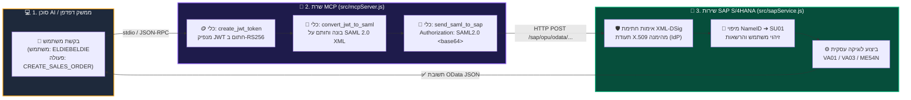
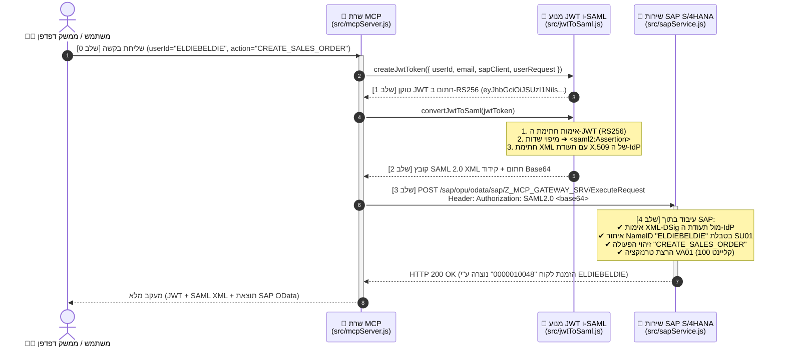
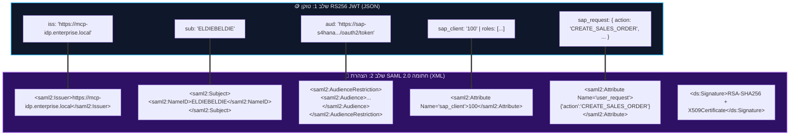

<div align="right">
  <a href="https://github.com/eldiebeldie">
    
  </a>
  
</div>

<div dir="rtl" align="center">

# ⚡️ MCP ➔ JWT ➔ SAML 2.0 ➔ SAP S/4HANA
### *סביבת ההדגמה האולטימטיבית להעברת זהות משתמש (Principal Propagation) מסוכני AI אל SAP*

[](https://github.com/eldiebeldie)
[](https://modelcontextprotocol.io)
[](https://www.sap.com)
[](#)
[](./LICENSE)

<p align="center">
  🌐 <a href="./README.md"><strong>Read in English (אנגלית)</strong></a> | 🇮🇱 <strong>קריאה בעברית</strong>
</p>

<p align="center">
  <strong>סוכני AI מודרניים מדברים ב-MCP ובטוקנים מסוג JWT. מערכות SAP ארגוניות מדברות ב-SAML 2.0 XML Assertions.</strong><br/>
  הפרויקט הזה מגשר בין שני העולמות תוך שניות — כולל <strong>שרת MCP אמיתי</strong>, המרה קריפטוגרפית מ-<strong>JWT ל-SAML 2.0</strong>, שירות <strong>SAP S/4HANA מדומה</strong>, וממשק <strong>ויזואליזציה אינטראקטיבי בזמן אמת</strong>.
</p>

</div>

---

<div dir="rtl">

## 🎯 הסיפור מאחורי הפרויקט: למה זה בכלל קיים?

דמיינו סוכן AI שרוצה ליצור הזמנת לקוח (`VA01`) או לאשר דרישת רכש (`ME54N`) במערכת **SAP S/4HANA** בשמו של משתמש אנושי אמיתי (`ELDIEBELDIE`).
בעולם הארגוני, **לעולם** לא נרצה להשתמש במשתמש מערכת טכני משותף ב-SAP — אנחנו חייבים **Principal Propagation (העברת זהות משתמש)** כדי ש-SAP תדע בדיוק *מי* האדם האמיתי שעומד מאחורי הבקשה, תבדוק את ההרשאות שלו ב-`SU01`, ותתעד את שם המשתמש המדויק ביומן הביקורת (Audit Log).

כך הזרימה שלנו הופכת את התהליך לפשוט ומהיר:
1. 🗣️ **אתם שולחים בקשה לשרת ה-MCP** לבצע פעולה עסקית ב-SAP עבור משתמש מסוים.
2. 🪙 **שרת ה-MCP מנפיק טוקן JWT חתום (RS256)** הכולל את זהות המשתמש ואת פרטי הבקשה העסקית.
3. 🧬 **טוקן ה-JWT מומר להצהרת OASIS SAML 2.0 Bearer Assertion**, הנחתמת דיגיטלית באמצעות תעודת X.509 (`XML-DSig RSA-SHA256`).
4. 🏢 **מערכת ה-SAP מקבלת את טוקן ה-SAML 2.0**, מאמתת את החתימה הקריפטוגרפית של ה-XML, מזהה את משתמש ה-SAP (`ELDIEBELDIE` או `ALICE_FIN`), מזהה את הפעולה העסקית המבוקשת, ומבצעת את הטרנזקציה ב-SAP!

---

## 🗺️ ארכיטקטורה וזרימת המידע באופן ויזואלי

### 1. תרשים זרימה עילי (`Client ➔ MCP ➔ JWT ➔ SAML 2.0 ➔ SAP`)

</div>



---

<div dir="rtl">

### 2. תרשים רצף מעמיק (Sequence Diagram — מעקב שלב-אחר-שלב על הקו)

</div>



---

<div dir="rtl">

### 3. אנטומיית הטוקנים: כיצד שדות ה-JWT הופכים ל-SAML 2.0 XML

</div>



---

<div dir="rtl">

## 🚀 איך מריצים את הדמו? (בפקודה אחת!)

יצרנו עבורכם סקריפט npm אחד שמרים את **שירות ה-SAP S/4HANA המדומה**, מחבר את **שרת ה-MCP**, ו**פותח אוטומטית את הדפדפן** בממשק הוויזואליזציה האינטראקטיבי:

</div>

```bash
npm run demo
```

<div dir="rtl">

*(או `npm start`)*

### מה קורה כשמריצים `npm run demo`:
1. **מופעל שרת SAP S/4HANA המדומה** בכתובת **[http://localhost:4004](http://localhost:4004)**.
2. **הדפדפן שלכם נפתח אוטומטית** בכתובת `http://localhost:4004`.
3. **מורצת זרימת MCP ➔ JWT ➔ SAML ➔ SAP מלאה בזמן אמת** ומוצגת בשני מקומות:
   - **בדפדפן**: כרטיסיות אינטראקטיביות עבור שלב 0 (הבקשה הראשונית), שלב 1 (טוקן ה-JWT), שלב 2 (קובץ ה-SAML 2.0 XML החתום), שלב 3 (בקשת ה-HTTP/1.1 המדויקת שנשלחת ל-SAP + פקודת `curl` + בקשת RFC 7522 OAuth2), ושלב 4 (תשובת ה-HTTP מ-SAP).
   - **בקונסול הטרמינל**: לוגים צבעוניים וקריאים לבני אדם + תוכן הבקשות המלא (JSON-RPC ו-HTTP).

> 💡 **מעדיפים להריץ רק בטרמינל ללא דפדפן?**
> הריצו `npm run demo:cli` כדי לבצע את כל התהליך בטרמינל ולצאת בצורה נקייה.

---

## 📡 הבקשות האמיתיות שנשלחות על הקו (למדו את הפרוטוקול!)

גם **ממשק הדפדפן (`http://localhost:4004`)** וגם **הטרמינל** מציגים את **בקשות ה-JSON-RPC וה-HTTP/1.1 המדויקות** שנשלחות בכל שלב:

### 1️⃣ שלב 0: בקשת MCP JSON-RPC 2.0 (`Client ➔ MCP Server`)

</div>

```json
{
  "jsonrpc": "2.0",
  "id": 1,
  "method": "tools/call",
  "params": {
    "name": "create_jwt_token",
    "arguments": {
      "userId": "ELDIEBELDIE",
      "email": "eldiebeldie@enterprise.local",
      "sapClient": "100",
      "action": "CREATE_SALES_ORDER",
      "parameters": {
        "customer": "CUST-1001",
        "amount": "18500.00",
        "material": "MAT-SAP-AI-CORE",
        "quantity": 2
      }
    }
  }
}
```

<div dir="rtl">

### 2️⃣ שלב 3א': בקשת HTTP/1.1 ישירה שנשלחת ל-SAP Gateway (`MCP ➔ SAP`)

</div>

```http
POST /sap/opu/odata/sap/Z_MCP_GATEWAY_SRV/ExecuteRequest HTTP/1.1
Host: localhost:4004
Content-Type: application/json
Accept: application/json
Authorization: SAML2.0 PHNhbWwyOkFzc2VydGlvbiB4bWxuczpzYW1sMj0idXJuOm9hc2lzOm5hbWVzOnRjOlNBTUw6Mi4wOmFzc2VydGlvbiIgSUQ9Il85N2E1Y2U2ZmZlNGM0ZDJiOTZkNDQ5ODY1MTczMTk5YiIgSXNzdWVJbnN0YW50PSIyMDI2LTEwLTIyVDIwOjQyOjE2LjM0MFoiIFZlcnNpb249IjIuMCI+...
Content-Length: 162

{
  "userRequest": {
    "action": "CREATE_SALES_ORDER",
    "parameters": {
      "customer": "CUST-1001",
      "material": "MAT-SAP-AI-CORE",
      "quantity": 2,
      "amount": "18500.00",
      "currency": "EUR"
    }
  }
}
```

<div dir="rtl">

### 3️⃣ שלב 3ב': בקשת HTTP חלופית לפי תקן SAP OAuth 2.0 SAML Bearer (RFC 7522)
במערכות SAP אמיתיות המוגדרות באמצעות טרנזקציה `SOAUTH2`, ניתן לשלוח את הצהרת ה-SAML 2.0 גם בפורמט `application/x-www-form-urlencoded` אל הנתיב `/sap/bc/sec/oauth2/token`:

</div>

```http
POST /sap/bc/sec/oauth2/token HTTP/1.1
Host: localhost:4004
Content-Type: application/x-www-form-urlencoded

grant_type=urn%3Aietf%3Aparams%3Aoauth%3Agrant-type%3Asaml2-bearer&assertion=PHNhbWwyOkFzc2VydGlvbiB4bWxu...
```

---

<div dir="rtl">

## 🖥️ איך נראים הלוגים בקונסול (מעקב קריא וברור)

בכל הרצה מודפס בטרמינל סיפור מעקב ברור ב-5 שלבים, כך שתוכלו לראות **מה נשלח בהתחלה**, **לאן זה נשלח**, ו**כיצד SAP מגיבה**:

</div>

```text
================================================================================
 🟢 [STEP 0 - INITIAL REQUEST SENT TO MCP SERVER]
================================================================================
  • From       : Client / Browser UI
  • Sent To    : MCP Server (src/mcpServer.js over stdio) -> Tool: "create_jwt_token"
  • Who (User) : ELDIEBELDIE (eldiebeldie@enterprise.local), SAP Client: 100
  • What Action: CREATE_SALES_ORDER

--------------------------------------------------------------------------------
 🔵 [STEP 1 - MCP CREATED SIGNED JWT TOKEN]
--------------------------------------------------------------------------------
  • Algorithm  : RS256 (Signed with IdP RSA Private Key)
  • JWT ID     : jwt_b67d5e4d-8faf-45f6-b4b2-adbb1acbd4c9
  • Subject    : ELDIEBELDIE
  • Audience   : https://sap-s4hana.enterprise.local/sap/bc/sec/oauth2/token
  • Embedded SAP Request: {"action":"CREATE_SALES_ORDER","parameters":{...}}

--------------------------------------------------------------------------------
 🟣 [STEP 2 - MCP CONVERTED JWT TO SIGNED SAML 2.0 ASSERTION]
--------------------------------------------------------------------------------
  • Sent To    : MCP Server -> Tool: "convert_jwt_to_saml"
  • SAML ID    : _97a5ce6ffe4c4d2b96d449865173199b
  • NameID     : ELDIEBELDIE
  • Signature  : Enveloped XML-DSig (RSA-SHA256 + X.509 Certificate)

--------------------------------------------------------------------------------
 🟠 [STEP 3 - ACTUAL HTTP REQUEST SENT TO SAP SERVICE]
--------------------------------------------------------------------------------
  • Sent From  : MCP Server -> Tool: "send_saml_to_sap"
  • Sent To URL: POST http://localhost:4004/sap/opu/odata/sap/Z_MCP_GATEWAY_SRV/ExecuteRequest
  • HTTP Header: Authorization: SAML2.0 PHNhbWwyOkFzc2VydGlvbiB4bWxuczpzYW1s...

--------------------------------------------------------------------------------
 ✅ [STEP 4 - ACTUAL HTTP RESPONSE RECEIVED FROM SAP SERVICE]
--------------------------------------------------------------------------------
  • Endpoint Hit     : POST /sap/opu/odata/sap/Z_MCP_GATEWAY_SRV/ExecuteRequest
  • SAML Signature   : VALID (Verified against trusted IdP X.509 Certificate)
  • Identified User  : ELDIEBELDIE — eldiebeldie (SAP Senior Architect) (SAP Client 100)
  • User Action      : CREATE_SALES_ORDER
  • SAP Transaction  : VA01 (Create Sales Order)
  • Execution Result : Sales Order 0000010048 created in SAP Client 100 by ELDIEBELDIE
================================================================================
```

---

<div dir="rtl">

## 🧰 פקודות הרצה ומבנה הפרויקט

| סקריפט | פקודה | מה הפקודה עושה |
| :--- | :--- | :--- |
| **דמו אינטראקטיבי (מומלץ)** | `npm run demo` | מפעיל את שירות ה-SAP וממשק הוויזואליזציה בפורט `4004` ו**פותח אוטומטית את הדפדפן**. |
| **דמו בטרמינל (CLI)** | `npm run demo:cli` | מריץ את כל זרימת MCP ➔ JWT ➔ SAML ➔ SAP בטרמינל ויוצא. |
| **שירות SAP בלבד** | `npm run start:sap` | מפעיל את שרת ה-SAP S/4HANA המדומה בכתובת `http://localhost:4004` ללא פתיחת דפדפן. |
| **שרת MCP (stdio)** | `npm run start:mcp` | מפעיל את [`src/mcpServer.js`](./src/mcpServer.js) מעל `stdio` לחיבור ל-Claude Desktop, Cursor או Antigravity. |

### קבצי המקור המרכזיים
- **[`src/cryptoKeys.js`](./src/cryptoKeys.js)** — מחולל אוטומטי של צמד מפתחות RSA-2048 ותעודת X.509 בחתימה עצמית (IdP) באמצעות מודול `crypto` המובנה ב-Node.js.
- **[`src/jwtToSaml.js`](./src/jwtToSaml.js)** — אחראי על יצירת טוקני RS256 JWT, בניית הצהרות OASIS SAML 2.0, חתימת XML-DSig, ואימות חתימות SAML.
- **[`src/mcpServer.js`](./src/mcpServer.js)** — שרת ה-MCP החושף את הכלים `execute_sap_request`, `create_jwt_token`, `convert_jwt_to_saml`, ו-`send_saml_to_sap`.
- **[`src/sapService.js`](./src/sapService.js)** — שירות SAP S/4HANA Gateway מדומה (`Z_MCP_GATEWAY_SRV` ו-`/sap/bc/sec/oauth2/token`) + ממשק הוויזואליזציה האינטראקטיבי בדפדפן.
- **[`src/demo.js`](./src/demo.js)** — מריץ אוטומטי בטרמינל (CLI) לבדיקה מהירה מקצה לקצה.

---

## 👨‍💻 יוצר הפרויקט וקרדיטים

<div align="center">

### נבנה באהבה ❤️ ובאמנות ארכיטקטורה ארגונית על ידי **eldiebeldie**

[](https://github.com/eldiebeldie)
[](https://github.com/eldiebeldie/jwttosaml)
[](mailto:eldargr@gmail.com)

> 💬 **רוצים להגיד תודה?**
> אם הפרויקט הזה עזר לכם או נתן לכם השראה, אתם מוזמנים בשמחה [להשאיר תגובה או כוכב ב-Repo](https://github.com/eldiebeldie/jwttosaml/issues) או לשלוח לי מייל קצר לכתובת **[eldargr@gmail.com](mailto:eldargr@gmail.com)** — **באנגלית ו/או בעברית (English and/or Hebrew)**! 🙏

*מגשרים בין עולם ה-Agentic AI (MCP) לארכיטקטורת SAP ארגונית — הופכים Principal Propagation לחוויה ויזואלית, מהנה ופשוטה.*

</div>

</div>

