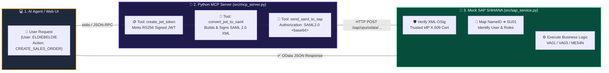
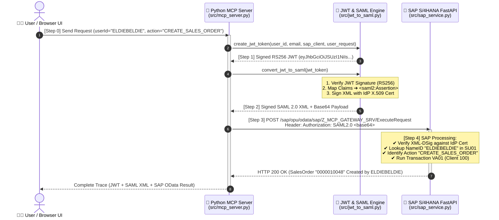
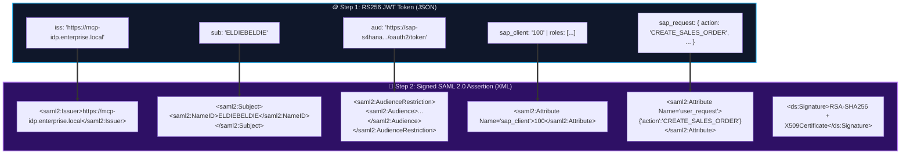

<div align="right">
  <a href="https://github.com/eldiebeldie">
    
  </a>
  
</div>

<div align="center">

# ⚡️ MCP ➔ JWT ➔ SAML 2.0 ➔ SAP S/4HANA (Python)
### *The Ultimate AI-Agent-to-SAP Principal Propagation Playground*

[](https://github.com/eldiebeldie)
[](https://www.python.org)
[](https://modelcontextprotocol.io)
[](https://www.sap.com)
[](#)
[](./LICENSE)

<p align="center">
  🌐 <strong>English</strong> | 🇮🇱 <a href="./README.he.md"><strong>קריאה בעברית (Hebrew)</strong></a>
</p>

<p align="center">
  <strong>Modern AI Agents speak MCP & JSON Web Tokens. Enterprise SAP speaks SAML 2.0 XML Assertions.</strong><br/>
  Built with the official <strong>Python MCP SDK (<code>MCPServer</code>)</strong>, <strong>FastAPI</strong>, <strong>PyJWT</strong>, and <strong>cryptography</strong> — complete with a live <strong>6-Theme Interactive Flow Studio</strong>.
</p>

</div>

---

## 🎯 The Story: Why Does This Exist?

Imagine an AI Agent wants to create a Sales Order (`VA01`) or approve a Purchase Requisition (`ME54N`) in **SAP S/4HANA** on behalf of a real user (`ELDIEBELDIE`).
You **never** want to use a shared technical system user in SAP — you need **Principal Propagation** so SAP knows *who* the real human is, checks their `SU01` roles, and logs their exact SAP user ID in the audit trail.

Here is how our Python flow makes that effortless:
1. 🗣️ **You ask the Python MCP Server** to perform an SAP action for a user.
2. 🪙 **MCP mints a signed RS256 JWT** capturing the user's identity and intent.
3. 🧬 **The JWT is transformed into an OASIS SAML 2.0 Bearer Assertion**, signed with an X.509 certificate (`XML-DSig RSA-SHA256`).
4. 🏢 **SAP receives the SAML 2.0 token**, verifies the cryptographic XML signature, identifies the SAP user (`ELDIEBELDIE` or `ALICE_FIN`), identifies their business request, and executes the SAP transaction!

---

## 🗺️ Visualized Architecture & Flows

### 1. The High-Level Pipeline (`Client ➔ MCP ➔ JWT ➔ SAML 2.0 ➔ SAP`)



---

### 2. Deep-Dive Sequence Diagram (Step-by-Step Wire Trace)



---

### 3. Token Anatomy: How JWT Claims Morph into SAML 2.0 XML



---

## 🚀 How to Run the Demo (1 Command!)

### Initial Setup (Once)
```bash
python -m venv .venv
.venv\Scripts\pip install -r requirements.txt
```

### Run the Interactive Demo & Open Browser
```bash
python run_demo.py
```

### What Happens When You Run `python run_demo.py`:
1. **Starts the SAP S/4HANA FastAPI Server** at **[http://localhost:4004](http://localhost:4004)**.
2. **Opens your default browser** directly to `http://localhost:4004` (featuring 6 themes: `Dark`, `Light`, `Cyberpunk`, `SAP Horizon`, `Emerald`, `Sunset`).
3. **Executes the live MCP ➔ JWT ➔ SAML ➔ SAP flow** and displays:
   - **In your Browser**: Interactive cards for Step 0 (Initial Request), Step 1 (JWT), Step 2 (Signed SAML 2.0 XML), Step 3 (Raw HTTP/1.1 Request to SAP + `curl` + RFC 7522 OAuth2), and Step 4 (SAP HTTP Response).
   - **In your Terminal Console**: Color-coded, human-readable logs + full raw JSON-RPC and HTTP wire payloads.

> 💡 **Prefer a pure terminal run?**
> Run `python run_demo.py --cli` to execute the entire flow in your terminal and exit cleanly.

---

## 📡 Actual Wire & HTTP Requests Sent (Learn the Protocol!)

Both the **Web Visualizer (`http://localhost:4004`)** and the **Terminal Console** log the **exact raw JSON-RPC and HTTP/1.1 requests** sent at each step:

### 1️⃣ Step 0: MCP JSON-RPC 2.0 Request (`Client ➔ Python MCP Server`)
```json
{
  "jsonrpc": "2.0",
  "id": 1,
  "method": "tools/call",
  "params": {
    "name": "create_jwt_token",
    "arguments": {
      "userId": "ELDIEBELDIE",
      "email": "eldiebeldie@enterprise.local",
      "sapClient": "100",
      "action": "CREATE_SALES_ORDER",
      "parameters": {
        "customer": "CUST-1001",
        "amount": "18500.00",
        "material": "MAT-SAP-AI-CORE",
        "quantity": 2
      }
    }
  }
}
```

### 2️⃣ Step 3A: Direct Raw HTTP/1.1 Request Sent to SAP Gateway (`MCP ➔ SAP`)
```http
POST /sap/opu/odata/sap/Z_MCP_GATEWAY_SRV/ExecuteRequest HTTP/1.1
Host: localhost:4004
Content-Type: application/json
Accept: application/json
Authorization: SAML2.0 PHNhbWwyOkFzc2VydGlvbiB4bWxuczpzYW1sMj0idXJuOm9hc2lzOm5hbWVzOnRjOlNBTUw6Mi4wOmFzc2VydGlvbiIgSUQ9Il85N2E1Y2U2ZmZlNGM0ZDJiOTZkNDQ5ODY1MTczMTk5YiIgSXNzdWVJbnN0YW50PSIyMDI2LTEwLTIyVDIwOjQyOjE2LjM0MFoiIFZlcnNpb249IjIuMCI+...
Content-Length: 162

{
  "userRequest": {
    "action": "CREATE_SALES_ORDER",
    "parameters": {
      "customer": "CUST-1001",
      "material": "MAT-SAP-AI-CORE",
      "quantity": 2,
      "amount": "18500.00",
      "currency": "EUR"
    }
  }
}
```

### 3️⃣ Step 3B: Alternative SAP Standard OAuth 2.0 SAML Bearer HTTP Request (RFC 7522)
In production SAP systems configured via transaction `SOAUTH2`, the SAML 2.0 Assertion can also be sent via `application/x-www-form-urlencoded` to `/sap/bc/sec/oauth2/token`:
```http
POST /sap/bc/sec/oauth2/token HTTP/1.1
Host: localhost:4004
Content-Type: application/x-www-form-urlencoded

grant_type=urn%3Aietf%3Aparams%3Aoauth%3Agrant-type%3Asaml2-bearer&assertion=PHNhbWwyOkFzc2VydGlvbiB4bWxu...
```

---

## 🧰 Commands & Architecture

| Mode | Command | What It Does |
| :--- | :--- | :--- |
| **Interactive Demo (Recommended)** | `python run_demo.py` | Starts SAP FastAPI + Flow Studio UI on port `4004` and **auto-opens the browser**. |
| **CLI Demo** | `python run_demo.py --cli` | Runs the end-to-end MCP ➔ JWT ➔ SAML ➔ SAP flow in the terminal and exits. |
| **SAP Service Only** | `python -m src.sap_service` | Starts the Mock SAP S/4HANA server on `http://localhost:4004` without opening a browser. |
| **MCP Server (stdio)** | `python -m src.mcp_server` | Runs [`src/mcp_server.py`](./src/mcp_server.py) over `stdio` for Claude Desktop, Cursor, or Antigravity. |

### Key Source Files
- **[`src/crypto_keys.py`](./src/crypto_keys.py)** — Zero-config RSA-2048 keypair & self-signed X.509 v3 IdP certificate generator using Python `cryptography`.
- **[`src/jwt_to_saml.py`](./src/jwt_to_saml.py)** — Mints RS256 JWTs (`PyJWT`), builds OASIS SAML 2.0 Assertions, signs them with Enveloped XML-DSig (`RSA-SHA256`), and verifies SAML assertions.
- **[`src/mcp_server.py`](./src/mcp_server.py)** — Official Python MCP Server (`MCPServer`) exposing `execute_sap_request`, `create_jwt_token`, `convert_jwt_to_saml`, and `send_saml_to_sap`.
- **[`src/sap_service.py`](./src/sap_service.py)** — FastAPI Mock SAP S/4HANA Gateway (`Z_MCP_GATEWAY_SRV` & `/sap/bc/sec/oauth2/token`) + Live 6-Theme Web Flow Studio UI.
- **[`src/demo.py`](./src/demo.py)** — Automated CLI runner for terminal verification.
- **[`run_demo.py`](./run_demo.py)** — One-command launcher that automatically uses `.venv` if present.

---

## 👨‍💻 Author & Credits

<div align="center">

### Crafted with ❤️ & Enterprise Wizardry by **eldiebeldie**

[](https://github.com/eldiebeldie)
[](https://github.com/eldiebeldie/jwttosaml)
[](mailto:eldargr@gmail.com)

> 💬 **Want to say thank you?**
> If this project helped you or inspired your architecture, feel free to [leave a comment or star in the repo](https://github.com/eldiebeldie/jwttosaml/issues) or send me a short email at **[eldargr@gmail.com](mailto:eldargr@gmail.com)** — in **English and/or Hebrew (אנגלית ו/או עברית)**! 🙏

*Bridging Agentic AI (MCP) with Enterprise SAP Architecture — Making Principal Propagation Fun, Visual, and Effortless.*

</div>
